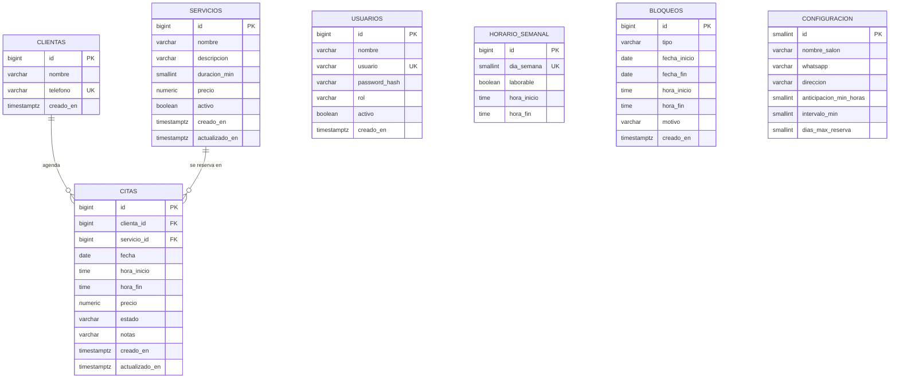

# Modelo de datos

Base de datos **PostgreSQL**. El esquema se crea y versiona con migraciones **Flyway**.

## Diagrama entidad-relación



**Relaciones**
- Una **clienta** tiene cero o muchas **citas**; cada cita pertenece a una sola clienta.
- Un **servicio** aparece en cero o muchas **citas**; cada cita es de un solo servicio.
- `USUARIOS`, `HORARIO_SEMANAL`, `BLOQUEOS` y `CONFIGURACION` son tablas independientes: el sistema tiene una sola profesional, por lo que el horario y los bloqueos no necesitan relacionarse con un usuario.

## Diccionario de datos

### usuarios
Cuenta de acceso al panel (la dueña).

| Columna | Tipo | Restricciones | Descripción |
|---|---|---|---|
| id | `BIGSERIAL` | PK | Identificador. |
| nombre | `VARCHAR(100)` | NOT NULL | Nombre para mostrar. |
| usuario | `VARCHAR(50)` | NOT NULL, UNIQUE | Nombre de inicio de sesión. |
| password_hash | `VARCHAR(100)` | NOT NULL | Contraseña cifrada con BCrypt. |
| rol | `VARCHAR(20)` | NOT NULL, DEFAULT `'ADMIN'` | Rol de Spring Security. |
| activo | `BOOLEAN` | NOT NULL, DEFAULT `TRUE` | Permite deshabilitar el acceso. |
| creado_en | `TIMESTAMPTZ` | NOT NULL, DEFAULT `now()` | Fecha de creación. |

### servicios
| Columna | Tipo | Restricciones | Descripción |
|---|---|---|---|
| id | `BIGSERIAL` | PK | Identificador. |
| nombre | `VARCHAR(100)` | NOT NULL | Nombre del servicio. |
| descripcion | `VARCHAR(255)` | | Descripción breve para la clienta. |
| duracion_min | `SMALLINT` | NOT NULL, CHECK `> 0 AND % 15 = 0` | Duración en minutos (RN-01). |
| precio | `NUMERIC(10,2)` | NOT NULL, CHECK `>= 0` | Precio vigente. |
| activo | `BOOLEAN` | NOT NULL, DEFAULT `TRUE` | Se desactiva en lugar de borrarse (RN-10). |
| creado_en / actualizado_en | `TIMESTAMPTZ` | NOT NULL, DEFAULT `now()` | Auditoría básica. |

### horario_semanal
Un registro por día de la semana (siete en total).

| Columna | Tipo | Restricciones | Descripción |
|---|---|---|---|
| id | `BIGSERIAL` | PK | Identificador. |
| dia_semana | `SMALLINT` | NOT NULL, UNIQUE, CHECK `BETWEEN 1 AND 7` | ISO-8601: 1 = lunes … 7 = domingo (igual que `java.time.DayOfWeek`). |
| laborable | `BOOLEAN` | NOT NULL | Si la dueña trabaja ese día. |
| hora_inicio | `TIME` | | Apertura. |
| hora_fin | `TIME` | CHECK `NOT laborable OR hora_inicio < hora_fin` | Cierre. |

### bloqueos
| Columna | Tipo | Restricciones | Descripción |
|---|---|---|---|
| id | `BIGSERIAL` | PK | Identificador. |
| tipo | `VARCHAR(10)` | NOT NULL, CHECK `IN ('DIA','RANGO','HORAS')` | Tipo de bloqueo. |
| fecha_inicio | `DATE` | NOT NULL | Primer día bloqueado. |
| fecha_fin | `DATE` | NOT NULL, CHECK `fecha_fin >= fecha_inicio` | Último día bloqueado (igual a `fecha_inicio` para `DIA` y `HORAS`). |
| hora_inicio | `TIME` | Solo para `HORAS` | Inicio del bloqueo parcial. |
| hora_fin | `TIME` | Solo para `HORAS`, CHECK `hora_inicio < hora_fin` | Fin del bloqueo parcial. |
| motivo | `VARCHAR(150)` | | Texto libre (vacaciones, personal…). |
| creado_en | `TIMESTAMPTZ` | NOT NULL, DEFAULT `now()` | Fecha de creación. |

### clientas
| Columna | Tipo | Restricciones | Descripción |
|---|---|---|---|
| id | `BIGSERIAL` | PK | Identificador. |
| nombre | `VARCHAR(100)` | NOT NULL | Nombre de la clienta. |
| telefono | `VARCHAR(10)` | NOT NULL, UNIQUE, CHECK `~ '^[0-9]{10}$'` | WhatsApp a 10 dígitos; identifica a la clienta (RN-11). |
| creado_en | `TIMESTAMPTZ` | NOT NULL, DEFAULT `now()` | Primera reserva. |

### citas
| Columna | Tipo | Restricciones | Descripción |
|---|---|---|---|
| id | `BIGSERIAL` | PK | Identificador. |
| clienta_id | `BIGINT` | NOT NULL, FK → `clientas.id` | Quién agenda. |
| servicio_id | `BIGINT` | NOT NULL, FK → `servicios.id` | Servicio reservado. |
| fecha | `DATE` | NOT NULL | Día de la cita. |
| hora_inicio | `TIME` | NOT NULL | Inicio. |
| hora_fin | `TIME` | NOT NULL, CHECK `hora_inicio < hora_fin` | Fin = inicio + duración del servicio. |
| precio | `NUMERIC(10,2)` | NOT NULL | Precio copiado al reservar (RN-08). |
| estado | `VARCHAR(12)` | NOT NULL, DEFAULT `'PENDIENTE'`, CHECK `IN ('PENDIENTE','CONFIRMADA','COMPLETADA','CANCELADA')` | Ciclo de vida (RN-12). |
| notas | `VARCHAR(255)` | | Observaciones de la dueña. |
| creado_en / actualizado_en | `TIMESTAMPTZ` | NOT NULL, DEFAULT `now()` | Auditoría básica. |

**Índices:** `citas(fecha)` para la agenda y la disponibilidad; `citas(clienta_id)` para el historial de una clienta; `bloqueos(fecha_inicio, fecha_fin)` para buscar bloqueos por rango.

### configuracion
Tabla de una sola fila con los datos del salón.

| Columna | Tipo | Restricciones | Descripción |
|---|---|---|---|
| id | `SMALLINT` | PK, CHECK `id = 1` | Garantiza que solo exista una fila. |
| nombre_salon | `VARCHAR(100)` | NOT NULL | Nombre que se muestra en el sitio. |
| whatsapp | `VARCHAR(10)` | NOT NULL | Teléfono de la dueña para los enlaces de WhatsApp. |
| direccion | `VARCHAR(200)` | | Dirección del salón. |
| anticipacion_min_horas | `SMALLINT` | NOT NULL, DEFAULT `2` | Anticipación mínima para reservar (RN-05). |
| intervalo_min | `SMALLINT` | NOT NULL, DEFAULT `15` | Separación entre horarios ofrecidos (RN-02). |
| dias_max_reserva | `SMALLINT` | NOT NULL, DEFAULT `60` | Ventana máxima para reservar (RN-06). |

## Restricción anti-empalmes

La validación en Java evita ofrecer horarios ocupados, pero dos clientas podrían confirmar el mismo horario al mismo tiempo. Para que eso sea imposible, PostgreSQL rechaza directamente cualquier cita activa que se traslape con otra:

```sql
-- Se impide que dos citas activas se traslapen en el tiempo
ALTER TABLE citas
  ADD CONSTRAINT citas_sin_empalmes
  EXCLUDE USING gist (
    tsrange(fecha + hora_inicio, fecha + hora_fin) WITH &&
  )
  WHERE (estado IN ('PENDIENTE', 'CONFIRMADA'));
```

- `tsrange(...)` convierte cada cita en un intervalo de tiempo.
- `&&` es el operador "se traslapa con".
- El `WHERE` excluye las citas canceladas y completadas, así que cancelar una cita libera su horario (RN-07).
- Si se intenta insertar una cita empalmada, PostgreSQL lanza un error de violación de restricción que la aplicación traduce a un mensaje amable: *"Ese horario acaba de ocuparse, elige otro"*.
